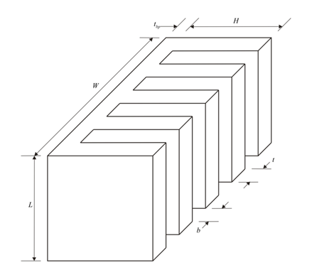

# Models in `aipe_thermal`

All quantities are SI: metres, kilograms, seconds, watt, pascal, kelvin for temperature differences and degrees
Celsius (`*_C`) for absolute temperatures (`*_K` accepted in JSON/dictionary inputs). Everything below is an
analytical screening correlation with the stated validity range; every evaluation returns its `validity` notes and
`warnings`. Nothing here is a CFD, FEM or measured result.

## 1. Plate-fin heat-sink correlation model (`aipe_thermal.heatsink`, CC BY 4.0)

Symbols: `L` fin length (flow / vertical direction), `W` base width, `H` fin height, `t` fin thickness, `b`
requested gap, `b_eff = (W - n t)/(n - 1)` effective gap, `n = floor((W - t)/(t + b)) + 1` fins, `t_bp` base
thickness. `PlateFinHeatSink(length, width, fin_height, fin_thickness, fin_gap, base_thickness, material)`.

1. **Air properties** at the film temperature `T_amb + dT/2`: ideal-gas density, Sutherland viscosity and
   conductivity, quadratic `c_p` fit, `beta = 1/T` (within about 0.5 % of Incropera & DeWitt Table A.4 for
   250-450 K). `air_properties(T_K)`, `film_temperature_K(t_ambient_C, delta_T_K)`.
2. **Natural convection** (vertical isothermal plates, laminar, `b << L`, open channel ends): Elenbaas number
   `El = rho^2 g beta c_p b^4 dT/(mu k L)`, Bar-Cohen & Rohsenow composite `Nu_b = [576/El^2 + 2.873/El^0.5]^-0.5`,
   `h = Nu_b k/b`; optimum spacing `b_opt = 2.714 L/Ra_L^0.25` (El = 54.3). Warnings outside 0.1 <= El <= 1e5 and
   for `b > L/4`. Optional linearised radiation `eps sigma (Ts^2 + Ta^2)(Ts + Ta)` on the wetted area (upper bound).
3. **Forced convection** (fully ducted flow, no bypass): `Re_b* = Re_b b/L`, Teertstra-Yovanovich-Culham composite
   `Nu_b = [(Re_b* Pr/2)^-3 + (0.664 Re_b*^0.5 Pr^(1/3) (1 + 3.65/Re_b*^0.5)^0.5)^-3]^(-1/3)` referenced to the inlet
   temperature (validated by the authors for about 0.1 <= Re_b* <= 100); Gnielinski on the hydraulic diameter when
   `Re_Dh >= 2300` plus the caloric term `1/(2 m_dot c_p)`; warnings for `b/H > 0.5` and transitional Re.
4. **Pressure drop**: `dp = (K_c + K_e + 4 f_app L/D_h) rho V^2/2`, `K_c = 0.42 (1 - sigma^2)`,
   `K_e = (1 - sigma^2)^2` (Kays & London asymptotes as used by Culham & Muzychka), Muzychka-Yovanovich developing
   laminar friction `f_app Re = sqrt((3.44/L*^0.5)^2 + (f Re)_fd^2)`, Petukhov when turbulent. **Fan operating
   point**: Brent solve of `dp_fan(Q/n_fans) = dp_sink(Q)` on a piecewise-linear fan curve `[(Q, dp), ...]`; fan power
   `Q dp/eta_fan` (`fan_operating_point`, `fan_curve_pressure`, `fan_power`).
5. **Fin efficiency**: `m = sqrt(h P/(k A_c))`, `P = 2 (L + t)`, `A_c = L t`, `eta = tanh(m H_c)/(m H_c)` (adiabatic
   tip, or Harper-Brown `H_c = H + t/2`); warning below 0.8.
6. **Resistance chain**: `R_conv = 1/((h + h_rad)(A_base,exposed + n eta P H))`; base `t_bp/(k A)` plus
   Lee-Song-Au-Moran closed-form spreading per device footprint (power-weighted partition of the base into cells,
   back-face coefficient `h_eff = 1/(R_conv A_base)`); `R_total = R_conv + max_i P_i (R_1D,i + R_sp,i)/sum P`
   (hottest footprint). `spreading_resistance`, `HeatSource`, `heat_sink_resistance`.
7. **Heat-load solve**: `OperatingPoint(heat_W=...)` solves `dT = Q R(dT)` by damped fixed-point iteration with the
   air properties re-evaluated at the film temperature each step (Brent fallback); `delta_T_K` mode evaluates at a
   fixed rise. `evaluate(sink, op) -> HeatSinkPerformance` (JSON-serialisable, with the solver record).
8. **Mass and envelope**: `rho (W L t_bp + n L H t)`, `W L (t_bp + H)`.
9. **Pareto optimisation** (`optimise_pareto`, `DesignBounds`, `ParetoSettings`, `pareto_filter`): seeded
   `scipy.optimize.differential_evolution`; anchor runs per objective give utopia / nadir and the scale; weight sweep
   `min sum w_i (f_i - u_i)/s_i`; epsilon-constraint `min f_1 s.t. f_2 <= eps` (two objectives); pooled solutions
   filtered to the non-dominated set; knee point closest to utopia. Objectives: `r_th` (K/W, hottest footprint),
   `mass` (kg), optionally `fan_power_W`, `volume_m3`, `delta_T_K`. Design variables and default bounds:

   | Variable | Default range | Description |
   | --- | --- | --- |
   | `length` L | 0.05-0.1 m | fin length (flow / vertical direction) |
   | `width` W | 0.05-0.1 m | base width across the fins |
   | `fin_height` H | 0.02-0.1 m | fin height |
   | `fin_thickness` t | 0.001-0.005 m | fin thickness |
   | `fin_gap` b | 0.002-0.01 m | requested gap between fins |
   | `base_thickness` t_bp | 0.002-0.01 m | base thickness (enters conduction and spreading) |
   | `volumetric_flow` Q | user bounds | optional design variable for forced convection (m^3/s) |

   Materials (`MATERIALS`): Al-6063-T5 (209 W/m K, 2700 kg/m^3), Al-6061-T6, Al-pure, Cu-C11000 (391 W/m K,
   8940 kg/m^3), Cu-pure; aliases `aluminium`, `copper`.

The `legacy_*` functions keep the original `HS_main.py` formulas verbatim for regression use only; the corrections
relative to the original script are listed with file:line in `CHANGELOG.md` (1.0.0 section).

## 2. Shared-sink thermal network (`aipe_thermal.network`, MIT)

Each device `i` has its private path junction -> case (`r_jc`) -> interface (`r_cs`) -> local base region
(`r_spread`, from the heat-sink model's per-footprint `r_base_total`) into the shared sink node, cooled to the fluid
through `r_sa` (the heat-sink model's `r_convective`):

    T_sink = T_amb + (sum_i P_i) r_sa,   T_case,i = T_sink + P_i (r_spread,i + r_cs,i),   T_j,i = T_case,i + P_i r_jc,i

`solve_steady_state` returns every temperature with margins to the design and absolute limits; `allowable_power`
and `required_sink_resistance` invert the network. Transient: `FosterNetwork` (datasheet ladder
`Zth(t) = sum R_i (1 - exp(-t/tau_i))`), exact Foster -> Cauer conversion by continued fractions with rational
arithmetic, `CauerNetwork.zth` by Crank-Nicolson integration on a geometric time grid (better than 0.5 % against
the analytic Foster form), superposition for piecewise-constant power (`transient_junction_temperature`).

## 3. Electrothermal iteration (`aipe_thermal.electrothermal`, MIT)

Fixed point `Tj_k -> P(Tj_k) -> Tj_{k+1} = (1 - w) Tj_k + w T(P)` with pluggable loss callables per device
(`DeviceLossModel(conduction, switching)`), datasheet defaults `RdsOnModel` (two-point linear or power law in Tj)
and `SwitchingEnergyModel` (`E_ref (V/V_ref)^a (I/I_ref)^b [1 + k_T (Tj - T_ref)]`), convergence on `tol_K` and
relative total-loss change, divergence detection (`t_abort_C`, "thermal runaway suspected"), adaptive relaxation,
full iteration history. `linear_fixed_point` is the closed-form check for a linear loss law.

## 4. Cooling-concept comparison (`aipe_thermal.cooling`, MIT)

Every option is evaluated the same way: sink model -> shared-sink network -> junction temperatures, optionally
closed with the electrothermal loop when the devices carry loss models.

* `NaturalConvectionOption(PlateFinGeometry, emissivity)` and `ForcedAirOption(PlateFinGeometry, volumetric_flow |
  fan_curve, n_fans, fan_efficiency, fan mass/volume/rated power)` use the heat-sink model above.
* `LiquidColdPlateOption`: `n_channels` parallel rectangular channels along `length`; coolant properties
  (water: Incropera & DeWitt Table A.6; 50/50 ethylene glycol: typical handbook values, +/-10 %) at the mean coolant
  temperature; fully developed laminar Shah-London Nusselt (uniform heat flux, entrance enhancement neglected,
  conservative) or Gnielinski / Dittus-Boelter when turbulent; channel walls as fins, lid adiabatic; caloric term
  `1/(2 m_dot c_p)` so the resistance is referenced to the inlet; Muzychka-Yovanovich / Petukhov friction plus
  minor losses; pump power `Q dp/eta_pump`; Lee-Song-Au-Moran spreading per footprint cell; external loop
  (pump, radiator) only if specified.
* Quantitative outputs per option: maximum junction temperature, sink-to-fluid and hottest-footprint resistances,
  mass, volume, auxiliary power, pressure drop, electrothermal record. Qualitative criteria (acoustic, reliability,
  isolation at 800 V, leakage, condensation, dust, bypass, ...) are returned as explicit `review_items`, never as
  numbers.

## 5. Stage A heat-sink screening (`aipe_thermal.screening`, MIT)

`StageATask` (devices, ambient, cooling kind, materials, bounds, optional flow bounds / fan curve, objectives,
seed and optimiser settings, junction limit) -> `run_stage_a`: one seeded Pareto run per material (seed + 1000 x
material index), pooled non-dominated set, shared-sink junction check per candidate (`r_sa = r_convective`,
`r_spread` = footprint `r_base_total`), distance to utopia, and FEM-verification flags for the knee point, the
lightest feasible design and the lowest-resistance design (`n_flag`). Stage B (FEM/CFD) is named as the next stage
and is not performed.

## 6. AIPE 10 kW DAB case (`aipe_thermal.cases.dab_10kw`, MIT)

Inputs: AIPE executed waveform summary (per-switch RMS and turn-off currents, ZVS condition), TI TIDA-010054 fact
sheet values (R_DS(on), Rth(j-c), pads, 0.5 K/W catalogue sink, 54 W calculated turn-off loss) and the same-family
hot/cold R_DS(on) pair of the SiC shortlist. `loss_estimates`, `build_devices`, `cooling_options` (assumed
geometries: natural Al 200 x 200 x 88 mm, forced Al 100 x 100 x 46 mm with two 60 mm fans, liquid Al 100 x 100 mm
plate with 16 mini-channels and water at 2 L/min), `ti_reference_network` cross-check and `run_dab_case`. Every
derived number is labelled an AIPE analytical estimate or an explicit assumption (`ASSUMPTIONS`); the turn-off
placeholder and the R_DS(on) temperature factor are to be replaced by the semiconductor-database evaluator.

## 7. Units and validation (`aipe_thermal.units`, MIT)

Absolute temperatures carry `_C` (or `_K` in inputs, converted); values above 300 degC for ambient/coolant and above
600 degC for any absolute temperature are rejected as "looks like kelvin"; flows are m^3/s and values above 1 m^3/s
are rejected with the L/min / CFM conversion hint; all geometry must be positive and finite. Helpers:
`kelvin_from_celsius`, `celsius_from_kelvin`, `m3_s_from_lpm`, `m3_s_from_cfm`, `temperature_C_from_mapping`.

## Historic documentation

`docs/legacy/heat_sink_optimization_summary.html` is the original mathematical summary of the research script
(kept unchanged for attribution; its normalised equation and bounds refer to the pre-1.0.0 script).
